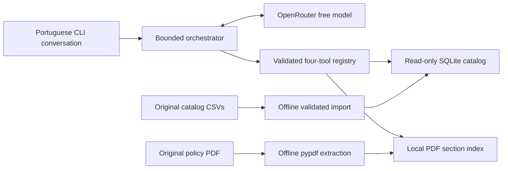

# Music Store AI Agent

A Python customer-service agent that answers in Brazilian Portuguese using a
music-instrument catalog and a store-policy manual. A real language model chooses
read-only tools; local Python code validates requests and retrieves the facts.

Customers often combine questions such as instrument availability and payment
conditions. This prototype connects those two sources in one conversation while
keeping prices, availability and policy rules traceable. **Music Store AI Agent**
is the project's independent portfolio identity; **Empório da Música** is the
fictional store used in the supplied scenario.

## What it does

- Searches instruments by name, exact category, price range and availability.
- Retrieves product descriptions, specifications and category listings.
- Finds policy sections covering payment, hours, shipping, returns and warranty,
  with page references and explicit cautions for conflicting information.
- Handles combined catalog/policy questions and simple session follow-ups.
- Redirects unrelated requests and gives a safe pt-BR fallback when evidence,
  tools or the model service are unavailable.

The interface is a local terminal. Catalog data is a **CSV snapshot**, and the
manual is a **June 2025 document**. Neither establishes live inventory, current
promotions or an actual customer action.

## Feature status

- **F-01 Data foundation and catalog tools:** implemented and verified.
- **F-02 Policy retrieval:** implemented and verified.
- **F-03 LLM orchestration and CLI:** implemented and verified.
- **F-04 Evaluation and delivery:** implemented and verified; four authentic
  Portuguese conversations are retained.
- **F-05 Latency, provider resilience and tool selection:** implemented,
  approved with documented limitations, and merged in PR #5. Offline
  verification passes (633 tests). Owner-observed real Nemotron outcomes are
  mixed: greeting, product search/price and policy retrieval succeeded; budget
  recommendation returned `INVALID_ARGUMENT` and category listing returned
  `GROUNDING_FAILED`.
- **F-06A Catalog retrieval and grounding reliability:** local implementation
  and offline verification complete; **Gate V pending human review**. Supported
  BRL punctuation, bounded customer-budget provenance and complete scoped
  minimum checks have regression coverage. No real-model run was performed.
- **Other F-06 workstreams:** future proposals only. See
  [docs/architecture/F-06-proposed-roadmap.md](docs/architecture/F-06-proposed-roadmap.md).

## Run locally

Requirements: **Python 3.11+**, `venv` and `pip`. Run the following commands from
the repository root. Installation downloads dependencies; catalog/index builds,
tests and `--help` do not need model credentials or model API access.

```bash
python3 -m venv .venv
.venv/bin/python -m pip install -e '.[dev]'

.venv/bin/python -m scripts.build_catalog \
  --data-dir data/raw \
  --output data/generated/catalog.sqlite

.venv/bin/python -m scripts.build_policy_index \
  --input 'resources/políticas_da_loja.pdf' \
  --output data/generated/policy_index.json

.venv/bin/python -m pytest -q
.venv/bin/python -m pip check
.venv/bin/python -m app --help
```

The supplied inputs must be present at their original paths. Catalog generation
uses only `desafio_tecnico_ai_eng - categories.csv` and
`desafio_tecnico_ai_eng - products.csv`; it validates and loads **9 categories
and 65 products**. Policy generation extracts **28 numbered sections across 8
pages**, retaining titles, physical page numbers and source provenance. Generated
artifacts belong in the ignored `data/generated/` directory; the builders leave
the supplied CSVs and PDF unchanged.

For a new checkout, create the ignored local configuration file:

```bash
cp .env.example .env
```

Keep an existing `.env` if you already have one. Edit the file locally, replacing
the placeholder key and selecting the model used for the successful real runs:

```dotenv
EMPORIO_LLM_API_KEY=your-openrouter-api-key
EMPORIO_LLM_BASE_URL=https://openrouter.ai/api/v1
EMPORIO_LLM_MODEL=nvidia/nemotron-3-ultra-550b-a55b:free
EMPORIO_LLM_TIMEOUT=30
```

Then start the conversation:

```bash
.venv/bin/python -m app
```

Enter a question in Portuguese; `/sair`, `sair`, `exit`, Ctrl+C or EOF ends the
session. To display sanitized tool names and error codes:

```bash
.venv/bin/python -m app --debug-tools
```

The CLI checks both generated artifacts and configuration before starting. It
prints build instructions if an artifact is missing or invalid. Startup, exit
and `--help` make no model request; entering a customer message does.

## Configuration and free-model boundary

The HTTP client uses OpenRouter's Chat Completions endpoint at
`https://openrouter.ai/api/v1/chat/completions`. The successful live baseline is
**`nvidia/nemotron-3-ultra-550b-a55b:free`**. The checked-in `.env.example` defaults
to the also-approved **`openrouter/free`** router alias. Those are the only two
accepted request model IDs; other models and endpoints are rejected locally.

Every request sets zero price caps for prompt, completion, request and image
pricing. Same-model provider failover is OFF by default; it can be enabled only
with the explicit F-05 setting below and retains the exact model and free-only
checks. The benchmark requires it OFF. There are no automatic HTTP retries or
paid-model fallback. An explicit Nemotron request requires that same model ID in
the response; the free-router alias may return a validated concrete `:free`
model ID. Nonzero reported usage cost is rejected. These are application-level
controls; account billing was not independently audited.

Configuration is read from process environment variables and a literal local
`.env`; process settings take precedence. `OPENROUTER_API_KEY`,
`OPENROUTER_MODEL` and `OPENROUTER_BASE_URL` are accepted aliases.
`EMPORIO_LLM_TIMEOUT` accepts 1–30 seconds as an operation cap. Optional artifact overrides are
`EMPORIO_CATALOG_DB` and `EMPORIO_POLICY_INDEX`. The dotenv reader does not run
shell commands or expand variables.

## F-05 deadlines, diagnostics and benchmark

F-05 adds the following optional settings without changing an existing `.env`,
configured model or authorized-model allowlist:

| Setting | Default | Bounds |
| --- | --- | --- |
| `EMPORIO_LLM_REQUEST_DEADLINE` | 30 seconds | 1–30 seconds |
| `EMPORIO_LLM_TURN_DEADLINE` | 120 seconds | 5–120 seconds; at least the request deadline |
| `EMPORIO_LLM_MAX_TOKENS` | 768 | Integer, 128–2048 |
| `EMPORIO_LLM_PROVIDER_FAILOVER` | `false` | Literal `true` / `false`; same model only |

Each production HTTP request runs in a temporary standard-library subprocess.
The caller supervises its wall-clock budget, kills and reaps it on timeout or
interruption, and bounds IPC and response sizes. This can stop blocked DNS,
connect and response reads. HTTPS certificate validation and redirect refusal
remain enforced. The API key travels through private IPC, never command arguments
or diagnostics. A temporary worker is created per request; no persistent service
is installed. An explicitly injected `opener` is an offline testing seam; it
preserves existing mocked-client behavior and is not the production cancellation
mechanism.

The CLI also enforces a total turn budget on its POSIX main thread, including
local tool execution. Unsupported execution contexts fail closed rather than
claiming a hard deadline. Expiry returns a safe pt-BR fallback and starts no
further model request. OS scheduling and worker cleanup add a small tolerance;
a shorter timeout can increase fallback rates. `--debug-tools` exposes bounded,
allowlisted latency, HTTP status, validated model identity, request count and
tool outcomes without printing prompts, customer text, arguments, bodies or keys.

Run the synthetic benchmark offline from the repository root:

```bash
.venv/bin/python -m scripts.f05_benchmark
.venv/bin/python -m pytest -q tests/test_f05_benchmark.py
```

Its default mode reads no `.env`, opens no network connection and writes only a
sanitized JSON report to stdout. It exercises the actual orchestrator with
scripted function calls and synthetic source envelopes for budget, availability,
comparison, policy, combined, out-of-scope and follow-up scenarios. Fixture task
assertions and the host grounding guard score factual completion; they do not
establish arbitrary semantic truth. Synthetic tool dispatch reuses the production
argument-validation contract, so malformed or out-of-range arguments return
`INVALID_ARGUMENT` and cannot produce successful fixture evidence. Wrong tools or
missing budget arguments do not count as successful task selection.

The report separates end-to-end P50/P95 time (including failures), HTTP
completion reliability, correct tool choice, grounded answer success, safe
fallback behavior and final JSON compliance. HTTP success can coexist with
invalid final JSON or failed grounding. Fallback scores evaluate failed turns;
healthy turns are not counted as fallback successes. **Scripted measurements do
not prove real latency, model quality or customer-service improvement.** A
20-second timeout by itself proves no improvement in the customer experience.

Real mode is implemented but **NOT AUTHORIZED in this F-05 round**. It requires
separate explicit owner authorization for provider usage and the operator's
`--real --authorize-real` assertion. It uses synthetic questions and fixture
sources only, preserves the configured approved model, and refuses enabled
provider failover. The shared cap is **12 HTTP requests TOTAL**, including failed
requests across all scenarios in that run. No retries or paid fallback occur;
429, authentication errors and non-free routing/cost evidence stop the run.

Live mode defaults to a **bounded six-scenario subset requiring 11 scripted
requests**: budget, policy, combined, out-of-scope, catalog follow-up and product
details follow-up. The full eight-turn set requires 15, so it is not the default.
Use `--scenarios name1,name2` for an explicit canonical-order subset and
`--list-scenarios` to inspect names and request estimates without reading `.env`
or contacting a provider. Every report lists `selected_scenarios`,
`skipped_scenarios`, `skipped_scenario_reasons` and `planned_http_requests`;
omitted or cap-truncated scenarios are never silent. A turn stopped mid-scenario
by the cap has `execution_status: interrupted`. Select `follow_up_catalog` together
with `follow_up_details`; a details follow-up without its preceding catalog context
is refused before configuration or network use. Estimates describe the scripted
fixture path; a live model can need more requests and will still stop at the cap.
The cap is per invocation:
an authorized evaluation must not restart the script or run another model to
exceed the owner's total budget.

`nvidia/nemotron-3.5-lightning:free` and `google/gemma-4-26b-a4b-it:free` remain
documentation-only candidates. Neither is allowlisted or a runtime default.
Before any separately authorized evaluation, recheck model IDs, free pricing,
function-calling support and provider terms. A candidate must demonstrate catalog
searches, policy lookup, function calling, grounded answers and final JSON
compliance before the owner considers selection.

Free-provider routing provides no application-level guarantee against retention,
logging or use for provider improvement. Zero price does not imply zero retention
or exclusion from training. Provider-specific terms can differ and must be checked
before live use. Benchmarks may contain only synthetic customer questions; never
submit real customer records, secrets or sensitive conversations.

## Architecture and tool calling



The model interprets intent and chooses function calls. The host accepts only
the four registered tool names, validates JSON arguments, invokes the local
function, and sends its result back as a `role="tool"` message with the matching
call ID. The model then composes a response. A mixed instrument/payment question
can call both catalog and policy tools within the same turn.

Before displaying a factual answer, the orchestrator checks its final structured
envelope, current-turn sources and numerical grounding, preserves policy
cautions, and adds source/snapshot context. Evidence-free greetings,
clarifications and scope redirects use fixed pt-BR text after the model selects
the intent. Missing evidence or failed validation produces a fallback.

| Tool | Inputs and behavior |
| --- | --- |
| `search_products` | Optional `query` (2–120 characters), exact `category`, `price_min_cents`, `price_max_cents`, `availability` and `limit` (1–50; default 10). At least one query/category/price filter is required. Prices are integer BRL cents. Default availability is `available`; other values are `out_of_stock`, `coming_soon`, `discontinued` and `any`. |
| `get_product_details` | Positive integer `product_id`, obtained from the catalog. Returns description, specifications, price and availability. |
| `list_categories` | No arguments. Returns category descriptions and counts of registered products; these counts are not stock units. |
| `search_store_policies` | `query` (3–240 characters) and optional `limit` (1–5; default 3). Returns original section text, titles, pages, cautions and document provenance. |

Tools return structured success/error envelopes. Unknown tools, extra arguments,
duplicate JSON keys, booleans used as integers and invalid ranges are rejected.
Catalog lookups return explicit missing-product/category or unavailable-catalog
errors; policy lookup returns no matches or an unavailable-policy error when
appropriate. These conditions do not authorize a guessed answer.

## Technical choices

**SQLite for catalog facts.** Import validates keys, types, relations, prices
and statuses, then builds a reproducible local snapshot. Queries use bound
parameters and read-only connections. Availability is derived deterministically:
only active products with positive recorded stock are available; discontinued
and coming-soon statuses take precedence. Public results expose availability,
not exact stock quantities. Search uses normalized tokens and deterministic
ordering, with a truncation flag.

**Section retrieval for policies.** `pypdf` extracts the supplied manual locally.
The index is pinned to its expected document version and SHA-256. Explicit topic
aliases and lexical ranking select sections without embeddings, a vector
database or another model call. Contact and installment contradictions remain
visible; defect exchange and statutory warranty remain separate procedures.

**Small orchestration layer.** Standard-library HTTPS handles the model protocol;
`pypdf` is the only runtime dependency. No agent framework is required. Each turn
is bounded to four model requests, six tool calls, 12 KiB of serialized tool
results and 4 KiB of customer input. Up to 12 complete prior chat messages are
retained in memory. Transport request/response sizes and output tokens are also
bounded. The application does not persist chat history.

## Validation and authentic examples

The F-03 baseline recorded **448 passing deterministic tests** and four
successful real Nemotron scenarios: catalog, policy, combined and out of scope.
Catalog and policy scenarios observed actual function calls; the unrelated
request used no store tool. Earlier free-provider HTTP 404/429 failures remain
documented alongside the successful evidence.

F-04 re-ran the complete suite with network socket operations blocked:
**448 passed, 0 failed, 0 skipped** on Python 3.14.4. A fresh temporary clone on
Python 3.12.12 independently installed dependencies, rebuilt both artifacts,
passed the same **448 tests**, passed `pip check` and ran `python -m app --help`
successfully. No private `.env`, key or prebuilt artifact was copied into that
clone. See the F-04 report for exact commands, timings, the official acceptance
matrix and the reproduction at the final F-04 commit.

F-05 re-ran the complete suite: **633 passed, 0 failed, 0 skipped** on Python
3.14.4. This includes 448 pre-existing tests plus 185 F-05 tests. The F-05
benchmark remains offline by default; real mode is implemented but not authorized.
See [F-05 verification](docs/verification/F-05-verification.md) for exact
commands, the acceptance mapping and the owner-observed real Nemotron outcomes.

F-06A offline verification observed **736 passed, 0 failed, 0 skipped**: all 633
unchanged baseline tests plus 103 additive regressions. Tests first reproduced
punctuation, budget-provenance and partial-result comparison failures. A scripted
model with the actual read-only tool worker rejected the default ten-result
minimum claim and accepted the correct R$ 429,90 minimum from both complete
33-product query/category searches. This is local retrieval/guard evidence,
not live model-quality evidence. See [F-06A verification](docs/verification/F-06A-verification.md).

The additional F-04 catalog conversation reached the model and retrieved products,
but its final answer failed the grounding guard and became a safe fallback. The
four retained recordings include that failure and three historical conversations;
the combined conversation supplies successful catalog-answer evidence.

- [F-03 execution evidence](docs/verification/F-03-verification.md)
- [F-04 final verification and acceptance matrix](docs/verification/F-04-verification.md)
- [Authentic Portuguese conversations](examples/)

The offline suite exercises CSV validation/import, availability and money rules,
read-only queries, reproducibility, policy extraction/ranking, ambiguity handling,
tool schemas, mocked HTTP transport, CLI behavior, grounding and abuse/failure
boundaries. It does not require a private API key. Live model runs are separate
evidence and are not part of `pytest`.

## Limitations and data handling

- Free inference can be unavailable, rate limited or incompatible with required
  tool parameters. Successful historical runs do not guarantee future service.
- Catalog search has no stemming or semantic similarity. Exact categories,
  spelling and the default result limit affect retrieval. Policy retrieval is
  tailored to the supplied manual; replacing that PDF requires an explicit
  source/index update.
- Source and numeric checks reduce unsupported claims but cannot establish the
  truth of every sentence or prove every product/price pairing. The original
  combined live example includes unsupported wording about a discount being
  applied “no checkout”; it is retained and identified in the evidence.
- F-06A uses conservative wording for budget references and minimum claims.
  Repeating a budget requires the entire current customer message to be an
  affirmative declaration such as `Meu orçamento é R$ 500,00.`. The answer must
  start with `Seu orçamento é R$ 500,00.` and can then contain only explicit
  `FULL PRODUCT NAME por R$ PRICE.` clauses with supported product/price pairs.
  Longer customer requests can still receive verified product prices without
  repeating their budget. Scoped minimum answers require one complete matching
  current-turn search and an exact category/query template; missing metadata,
  truncation, price filters and ambiguous scope fail closed. The 50-result and
  12 KiB tool-output bounds remain. Recognized comparison phrases are guarded;
  arbitrary natural-language entailment and every possible paraphrase are not
  solved. No live-provider adherence or quality improvement is claimed.
- Prompt injection is treated as a trust boundary: customer text, CSV fields,
  PDF content and tool results are data. Mocked adversarial tests provide
  bounded evidence, not a claim that all attacks or hallucinations are solved.
- There is no order/customer lookup, payment, refund, mutation, shipping quote,
  actual human handoff, WhatsApp integration or deployment. The tools cannot
  execute arbitrary SQL or shell commands. Session messages and relevant
  retrieved excerpts are sent to OpenRouter during live conversations; use
  non-sensitive prompts.
- `.env`, generated databases/indexes and private traces are ignored by Git.
  The supplied materials include fictional customer/contact fields and an
  internal-use policy PDF. Owner authorization to retain and publish those
  original materials is recorded in the
  [F-01 dataset decision](docs/plans/F-01-implementation-plan.md) and
  [F-02 source decision](docs/specs/F-02-policy-retrieval.md). Those permissions
  do not authorize unrelated real customer data. The application imports only
  catalog products/categories; the unused customer/order files are not evidence
  of an implemented feature.

## Repository map

```text
app/catalog/          CSV validation, SQLite import and catalog tools
app/policy/           PDF extraction, section ranking and policy tool
app/agent/            Config, HTTP client, tool registry, orchestration and CLI
scripts/              Offline catalog and policy-index builders
tests/                Deterministic pytest suite and sanitized fixtures
examples/             Recorded Portuguese model conversations
docs/                 Constitution, feature specs/plans and verification evidence
data/raw/             Original supplied CSVs
resources/            Original supplied policy PDF
data/generated/       Ignored local builds and private execution artifacts
```

## Coding-assistant disclosure

ChatGPT/Codex assisted with requirements and specification drafting, planning,
Python implementation, test design, integration troubleshooting, documentation
and verification commands. The project owner sets architecture, scope,
acceptance criteria and approval boundaries. Verification reports distinguish
observed command results, mocked behavior, real-provider evidence and remaining
limitations; generated code or prose alone is not treated as proof of success.

## Repository and delivery status

Repository: [Sharpshooter171/music-store-ai-agent](https://github.com/Sharpshooter171/music-store-ai-agent).
The public F-05 release is `main @ 0a5a8bcaede2e8631a71715c32a3f14449b3e005`,
merged from PR #5 with Gate V approved and documented limitations. Other F-06
workstreams remain proposed in
[docs/architecture/F-06-proposed-roadmap.md](docs/architecture/F-06-proposed-roadmap.md).
F-06A is an authorized local change against `6d83c45484d31284fc6653b72d5b77c07ed6a888`,
pending human Gate V review; it has not been committed or published by this work.

See [F-05 verification](docs/verification/F-05-verification.md),
[final delivery review](docs/verification/FINAL-DELIVERY-REVIEW.md) and the
[delivery checklist](docs/verification/F-04-verification.md#delivery-checklist).
